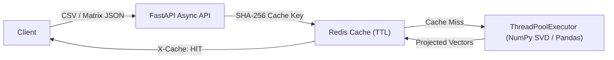

# VectorPulse Analytics Engine

High-throughput tabular data ingestion, vectorized matrix transformations, and Principal Component Analysis (PCA) dimensionality reduction service built with **FastAPI**, **NumPy**, **Pandas**, and **Redis** caching.

## Architecture



## Key Capabilities
- **CSV Tabular Ingestion (`POST /api/v1/datasets/ingest`)**: Validates and profiles numeric columns (`mean`, `std`, `min`, `max`) using Pandas.
- **SVD-based PCA (`POST /api/v1/analytics/pca`)**: Standardizes feature matrices and computes principal components + explained variance ratios.
- **Matrix Operations (`POST /api/v1/analytics/matrix-ops`)**: Supports `normalize`, `covariance`, and `correlation` transformations.
- **Deterministic Redis Caching**: Computes SHA-256 request signatures, returning `X-Cache: HIT | MISS` and `X-Process-Time-Ms` headers (with automatic in-memory fallback for local dev).

## Quickstart

```bash
# Run with Docker Compose (FastAPI + Redis)
docker compose up --build

# Or run locally
python3 -m venv .venv && source .venv/bin/activate
pip install -r requirements.txt
uvicorn app.main:app --reload
```

## Running Tests

```bash
pytest
```
